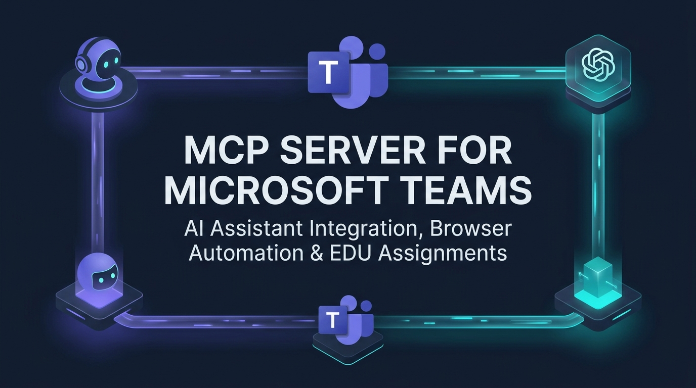
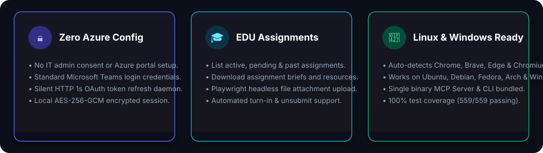
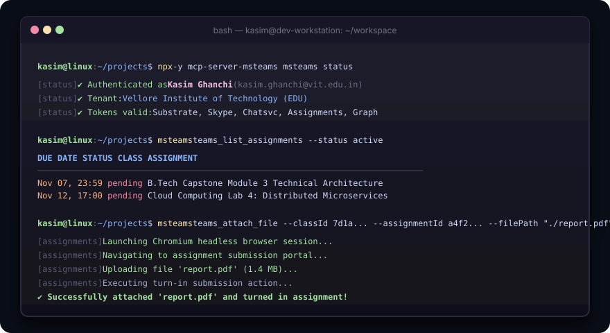

<div align="center">



# Microsoft Teams MCP Server &amp; CLI

**Direct AI Assistant Integration, EDU Assignment Automation &amp; Standalone CLI for Microsoft Teams**

[](https://github.com/kasim672/mcp-server-msteams/actions/workflows/ci.yml)
[](https://www.npmjs.com/package/mcp-server-msteams)
[](https://opensource.org/licenses/MIT)
[](https://nodejs.org/)
[](#linux-dual-boot--setup-guide)
[](#windows-setup-guide)

<br/>



</div>

---

## Table of Contents

- [Overview](#overview)
- [Quick Start](#quick-start)
  - [1. Configure in AI MCP Clients (Claude, Cursor, Windsurf, Zed)](#1-configure-in-ai-mcp-clients)
  - [2. Standalone Terminal CLI Usage](#2-standalone-terminal-cli-usage)
- [Architecture &amp; Data Flow](#architecture--data-flow)
- [CLI Commands vs MCP Tools Reference](#cli-commands-vs-mcp-tools-reference)
  - [Authentication &amp; Session](#authentication--session)
  - [EDU Coursework &amp; Assignments](#edu-coursework--assignments)
  - [Messaging &amp; Chats](#messaging--chats)
  - [Search &amp; Emails](#search--emails)
  - [Files &amp; Meeting Transcripts](#files--meeting-transcripts)
  - [People &amp; Contacts](#people--contacts)
- [Step-by-Step Assignment Workflow](#step-by-step-assignment-workflow)
- [Linux Dual-Boot &amp; Native Setup Guide](#linux-dual-boot--native-setup-guide)
  - [Prerequisites &amp; Browser Installation](#prerequisites--browser-installation)
  - [Cloning &amp; Local Verification](#cloning--local-verification)
  - [Environment Variables](#environment-variables)
- [Windows Setup Guide](#windows-setup-guide)
- [Development &amp; Testing](#development--testing)
- [Security &amp; Encryption](#security--encryption)
- [Troubleshooting &amp; FAQ](#troubleshooting--faq)
- [License](#license)

---

## Overview

**`mcp-server-msteams`** connects Large Language Models (Claude, GPT, Gemini, DeepSeek) and command-line users directly to Microsoft Teams. 

### Why Choose `mcp-server-msteams`?

- 🚀 **Zero Azure Setup**: No Azure App Registrations, no IT admin consent, and no Graph API portal configuration required. Sign in using your existing standard Teams credentials.
- ⚡ **Silent 1-Second HTTP Refresh**: Automatically mints and refreshes MSAL OAuth tokens via fast HTTPS endpoints in the background. The browser only opens for the initial login or if session cookies completely expire.
- 🎓 **First-Class EDU Assignments**: Automate listing coursework, reading rubrics, downloading assignment files, attaching local submissions (`.pdf`, `.docx`, `.zip`), and executing turn-in / unsubmit actions.
- 🐧 **Full Linux &amp; Windows Parity**: Native cross-platform engine auto-detects Google Chrome, Brave, Microsoft Edge, and Chromium across distributions without hardcoded `.exe` or OS paths.
- 🛡️ **End-to-End Local Security**: Session tokens are encrypted on disk with **AES-256-GCM** using machine-derived cryptographic keys. Your credentials never touch third-party servers.
- 🛠️ **Dual Interface**: Includes both an **MCP stdio server** for AI clients and the standalone **`msteams` CLI** for bash/zsh/PowerShell scripts.

---

## Quick Start

### 1. Configure in AI MCP Clients

Add `mcp-server-msteams` to your AI client's configuration file. The client will launch the server on-demand via `npx`:

#### Claude Desktop
Add to `%APPDATA%\Claude\claude_desktop_config.json` (Windows) or `~/.config/Claude/claude_desktop_config.json` (Linux/macOS):

```json
{
  "mcpServers": {
    "teams": {
      "command": "npx",
      "args": ["-y", "mcp-server-msteams@latest"]
    }
  }
}
```

#### Cursor &amp; Windsurf
Add to your project's `.cursor/mcp.json` or global MCP settings:

```json
{
  "mcpServers": {
    "teams": {
      "command": "npx",
      "args": ["-y", "mcp-server-msteams@latest"]
    }
  }
}
```

#### Local Clone Execution (For Local Development)
If you prefer to run from a local repository clone:

```json
{
  "mcpServers": {
    "teams": {
      "command": "node",
      "args": ["/absolute/path/to/mcp-server-msteams/dist/index.js"]
    }
  }
}
```

---

### 2. Standalone Terminal CLI Usage

You can use all features directly from your command prompt without an AI client.

#### Method A: Direct Execution (Fastest — If Installed Globally)
Install once from NPM:
```bash
npm install -g mcp-server-msteams
```

Then run commands anywhere in your terminal:
```bash
# Check session status
msteams status

# Sign in to Teams (opens browser once)
msteams login

# List active coursework
msteams assignments --status active
```

#### Method B: Running via NPX (Without Global Installation)
If you do not want to install globally, run using `npx`:

```bash
# Check session status
npx -y -p mcp-server-msteams msteams status

# Sign in to Teams (opens browser once)
npx -y -p mcp-server-msteams msteams login

# List active coursework
npx -y -p mcp-server-msteams msteams assignments --status active
```

*(Note for Windows Command Prompt users: In `cmd.exe`, do not paste bash comment lines starting with `#`)*.

---

## Architecture &amp; Data Flow

<div align="center">
  
</div>

1. **Protocol Layer**: Standard JSON-RPC 2.0 over standard I/O (MCP specification compliant).
2. **Session Engine**:
   - Stores session state in `~/.teams-mcp-server/` (Linux/macOS) or `%APPDATA%\teams-mcp-server\` (Windows).
   - Local token database encrypted with authenticated **AES-256-GCM**.
   - Persistent browser profile preserves Microsoft SSO cookies, enabling silent headless re-authentication.
3. **Multi-Service Cloud Gateway**:
   - **ChatSvc (`chatsvcagg.teams.microsoft.com`)**: Real-time messaging, channels, direct chats, reactions.
   - **Substrate (`substrate.office.com`)**: Microsoft 365 natural language search, Outlook emails, people graph.
   - **Assignments (`assignments.edu.cloud.microsoft`)**: Coursework data, submission deadlines, rubrics.
   - **Graph API (`graph.microsoft.com`)**: OneDrive files, SharePoint document libraries, meeting transcripts.

---

## CLI Commands vs MCP Tools Reference

The server exposes **30+ tools** to AI agents via MCP, each available as a direct command in the `msteams` CLI:

### Authentication &amp; Session

| MCP Tool Name | CLI Command | Parameters | Description |
| :--- | :--- | :--- | :--- |
| `teams_status` | `msteams status` | *(None)* | Check authentication status, tenant info, and token validity across all services. |
| `teams_login` | `msteams login` | *(None)* | Opens a visible browser window for Microsoft Teams login. Auto-saves session and closes. |

### EDU Coursework &amp; Assignments

| MCP Tool Name | CLI Command | Parameters | Description |
| :--- | :--- | :--- | :--- |
| `teams_list_assignments` | `msteams assignments` | `--status <active\|completed\|all>` | List coursework across classes with due dates, grades, and submission state. |
| `teams_get_assignment` | `msteams assignment` | `--classId <id> --assignmentId <id>` | Get detailed assignment instructions, attached files, rubrics, and submission info. |
| `teams_attach_file` | `msteams attach_file` | `--classId <id> --assignmentId <id> --filePath <path> [--turnIn]` | Attach a local file through Playwright; optional turn-in uses an API-verified submission state and requires classId + assignmentId. |
| `teams_remove_attachment` | `msteams remove_attachment` | `--classId <id> --assignmentId <id> [--fileName <name>]` | Remove an uploaded attachment from a working submission. |
| `teams_submission_action` | `msteams submission_action` | `--action <submit\|unsubmit\|view> --classId <id> --assignmentId <id> --submissionId <id>` | Turn in an assignment, undo turn-in, or mark as viewed. |

### Messaging & Chats

| MCP Tool Name | CLI Command | Parameters | Description |
| :--- | :--- | :--- | :--- |
| `teams_get_chat` | `msteams chat <userId>` | `--userId <id>` *(alias: `--user`)* | Resolve or start a 1:1 direct chat with a person; returns conversation ID. |
| `teams_list_chats` | `msteams chats` | `[--limit <n>]` | List recent conversations (1:1 chats, group chats, meetings, channels) newest activity first. |
| `teams_get_thread` | `msteams thread` | `[--conversationId <id>] [--fromUrl <url>] [--threadRootId <id>] [--limit <n>] [--order <asc\|desc>] [--since <iso>] [--markRead]` *(alias: `--to`)* | Read message history from a Teams conversation or channel thread. |
| `teams_send_message` | `msteams send_message <content>` | `[--conversationId <id>] [--replyToMessageId <id>] [--contentType <auto\|text\|html\|markdown>] [--subject <title>] [--scheduleAt <iso>]` *(aliases: `--to`, `--reply`)* | Send a message to a conversation (defaults to self-notes `48:notes`). Supports Markdown tables and @mentions. |
| `teams_get_message` | `msteams message` | `--conversationId <id> --messageId <id>` *(aliases: `--to`, `--msg`)* | Get a single message by ID with full content and metadata. |
| `teams_create_group_chat` | `msteams create_group_chat` | `--userIds <id1,id2,...> [--topic <title>]` | Create a new group chat with multiple people. |
| `teams_edit_message` | `msteams edit_message` | `--conversationId <id> --messageId <id> --content <text> [--contentType <type>]` *(aliases: `--to`, `--msg`)* | Edit the text content of a message you previously sent. |
| `teams_delete_message` | `msteams delete_message` | `--conversationId <id> --messageId <id>` *(aliases: `--to`, `--msg`)* | Delete a message sent by you (soft delete). |
| `teams_get_unread` | `msteams unread` | `[--conversationId <id>]` *(alias: `--to`)* | Fetch unread conversation status across Teams or for a specific conversation. |
| `teams_mark_read` | `msteams mark_read` | `--conversationId <id> --messageId <id>` *(aliases: `--to`, `--msg`)* | Mark a conversation as read up to a specific message. |
| `teams_wait_for_reply` | `msteams wait_for_reply` | `[--conversationId <id>] [--fromUrl <url>] [--maxWaitSeconds <n>] [--intervalSeconds <n>] [--includeSelf]` *(alias: `--to`)* | Block/poll until a new message arrives in a conversation. |
| `teams_get_activity` | `msteams activity` | `[--limit <n>] [--syncState <token>]` | Fetch your activity feed (mentions, reactions, replies, and notifications). |
| `teams_search_emoji` | `msteams emoji <query>` | `--query <text>` | Search for emojis by name or keyword. |
| `teams_add_reaction` | `msteams add_reaction` | `--conversationId <id> --messageId <id> --emoji <key>` *(aliases: `--to`, `--msg`)* | React to a message (`like`, `heart`, `laugh`, `surprised`, `sad`, `angry`, or custom emoji). |
| `teams_remove_reaction` | `msteams remove_reaction` | `--conversationId <id> --messageId <id> --emoji <key>` *(aliases: `--to`, `--msg`)* | Remove an emoji reaction from a message. |
| `teams_get_saved_messages` | `msteams saved_messages` | `[--limit <n>]` | List messages bookmarked/saved by the user. |
| `teams_save_message` | `msteams save_message` | `--conversationId <id> --messageId <id> [--rootMessageId <id>]` *(aliases: `--to`, `--msg`)* | Bookmark/save a message in Teams. |
| `teams_unsave_message` | `msteams unsave_message` | `--conversationId <id> --messageId <id> [--rootMessageId <id>]` *(aliases: `--to`, `--msg`)* | Remove a saved bookmark from a message. |
| `teams_get_followed_threads` | `msteams followed_threads` | `[--limit <n>]` | List channel threads you are following in Teams. |

### Search & Directory

| MCP Tool Name | CLI Command | Parameters | Description |
| :--- | :--- | :--- | :--- |
| `teams_search` | `msteams search <query>` | `[--maxResults <n>] [--from <n>] [--size <n>]` | Semantic natural language search across messages, chats, and channels with query operators. |
| `teams_search_email` | `msteams email <query>` | `[--maxResults <n>] [--from <n>] [--size <n>]` | Search your Exchange/Outlook inbox and sent mail from Teams context. |
| `teams_find_channel` | `msteams channel <query>` | `[--limit <n>]` | Find Teams channels by name. |
| `teams_search_people` | `msteams people <query>` | `[--limit <n>]` | Search institutional directory for colleagues, professors, and classmates by name or email. |

### Files & Meeting Transcripts

| MCP Tool Name | CLI Command | Parameters | Description |
| :--- | :--- | :--- | :--- |
| `teams_get_shared_files` | `msteams shared_files` | `--conversationId <id> [--pageSize <n>] [--skipToken <token>]` *(alias: `--to`)* | List files and links shared within a conversation with download URLs. |
| `teams_download_file` | `msteams download_file` | `--url <url> --outputPath <path>` | Securely download SharePoint, OneDrive, or assignment files to local disk. |
| `teams_get_meetings` | `msteams meetings` | `[--startDate <iso>] [--endDate <iso>] [--limit <n>]` | Retrieve upcoming and past calendar events and Teams meetings. |
| `teams_get_transcript` | `msteams transcript` | `--threadId <id> [--meetingDate <iso>]` | Download automated meeting transcripts with speaker timestamps. |
| `teams_get_tags` | `msteams tags` | `--teamId <id> [--query <text>]` | Get channel tags for a Teams team (used for `@mention` tags). |

### People & Contacts

| MCP Tool Name | CLI Command | Parameters | Description |
| :--- | :--- | :--- | :--- |
| `teams_get_me` | `msteams me` | *(None)* | Get profile details, tenant ID, and email of the logged-in user. |
| `teams_get_person` | `msteams person <mri>` | `--mris <mri,mri...>` | Look up detailed job title, department, and contact info for people by MRI. |
| `teams_get_frequent_contacts` | `msteams frequent_contacts` | `[--limit <n>]` | Get the list of contacts you interact with most frequently. |
| `teams_get_favorites` | `msteams favorites` | *(None)* | Get your favourite/pinned conversations in Teams. |
| `teams_add_favorite` | `msteams add_favorite` | `--conversationId <id>` *(alias: `--to`)* | Pin a conversation to favorites. |
| `teams_remove_favorite` | `msteams remove_favorite` | `--conversationId <id>` *(alias: `--to`)* | Remove a conversation from favorites. |

---

## Step-by-Step Assignment Workflow

<div align="center">
  
</div>

Here is how an AI assistant or student automates coursework using `msteams`:

### Step 1: Check Coursework Deadlines
```bash
msteams assignments --status active
```
*Output returns all pending homework, modules, quizzes, and due dates across your enrolled classes.*

### Step 2: Read Detailed Instructions &amp; Download Resources
```bash
msteams assignment --classId "19:abc...tacx" --assignmentId "a8f3b..."
```
*Returns teacher rubrics, point scales, and resource download URLs. Use `msteams download_file` to fetch reference slides or templates.*

### Step 3: Attach Local Submission File
```bash
# Attach file and optionally turn in immediately:
msteams attach_file \
  --classId "19:abc...tacx" \
  --assignmentId "a8f3b..." \
  --filePath "/path/to/report.pdf" \
  --turnIn
```
*Playwright opens the Teams assignment, uploads the file, and checks whether the attachment appears. For `--turnIn`, supply `--classId` and `--assignmentId` (the submission ID is resolved if omitted). The server uses the Assignments API to confirm the final submitted status instead of assuming an on-screen click succeeded. If attachment or turn-in verification fails, inspect the assignment in Teams before repeating the action.*

### Step 4: Undo Turn-In or Remove Attachment (If needed)
```bash
# Undo turn-in:
msteams submission_action --action unsubmit --classId "19:abc..." --assignmentId "a8f3b..." --submissionId "sub_01..."

# Remove attachment:
msteams remove_attachment --classId "19:abc..." --assignmentId "a8f3b..." --fileName "report.pdf"
```

---

## Linux Dual-Boot &amp; Native Setup Guide

If you are using Linux (Ubuntu, Debian, Fedora, Arch, Manjaro, Pop!_OS) or testing on a dual-boot setup:

### Prerequisites &amp; Browser Installation

Ensure you have **Node.js >= 20** and any Chromium-based browser installed:

#### 1. Install Node.js 20+
```bash
# Ubuntu / Debian
curl -fsSL https://deb.nodesource.com/setup_20.x | sudo -E bash -
sudo apt install -y nodejs git

# Fedora
sudo dnf install -y nodejs git

# Arch Linux
sudo pacman -S nodejs npm git
```

#### 2. Install or Use Your Default Browser
`mcp-server-msteams` **automatically detects your system's default browser** directly from your operating system settings (via `xdg-settings` on Linux, `UserChoice` registry on Windows, or AppleScript on macOS).

It coordinates with:
- **Chromium-based**: Google Chrome, Microsoft Edge, Brave, Opera, Vivaldi, Chromium
- **Non-Chromium**: Mozilla Firefox (uses dedicated `browser-profile-firefox` session with automated fallback to Chromium if remote debugging protocol is unavailable)

If you don't already have a browser installed on Linux, install any of the following:

```bash
# Option A: Google Chrome (Ubuntu / Debian)
wget https://dl.google.com/linux/direct/google-chrome-stable_current_amd64.deb
sudo apt install -y ./google-chrome-stable_current_amd64.deb

# Option B: Brave Browser (Ubuntu / Debian)
sudo curl -fsSLo /usr/share/keyrings/brave-browser-archive-keyring.gpg https://brave-browser-apt-release.s3.brave.com/brave-browser-archive-keyring.gpg
echo "deb [signed-by=/usr/share/keyrings/brave-browser-archive-keyring.gpg] https://brave-browser-apt-release.s3.brave.com/ stable main" | sudo tee /etc/apt/sources.list.d/brave-browser-release.list
sudo apt update && sudo apt install -y brave-browser

# Option C: Mozilla Firefox (Ubuntu / Debian)
sudo apt install -y firefox

# Option D: Chromium (Ubuntu / Debian)
sudo apt install -y chromium-browser

# Option E: Microsoft Edge (Ubuntu / Debian)
curl https://packages.microsoft.com/keys/microsoft.asc | gpg --dearmor > microsoft.gpg
sudo install -o root -g root -m 644 microsoft.gpg /etc/apt/trusted.gpg.d/
sudo sh -c 'echo "deb [arch=amd64] https://packages.microsoft.com/repos/edge stable main" > /etc/apt/sources.list.d/microsoft-edge-dev.list'
sudo apt update && sudo apt install -y microsoft-edge-stable
```

### Cloning &amp; Local Verification

```bash
# 1. Clone repository
git clone https://github.com/kasim672/mcp-server-msteams.git
cd mcp-server-msteams

# 2. Install dependencies & build
npm install
npm run build

# 3. Run unit tests (574 tests)
npm test

# 4. Sign in to Teams (opens browser GUI)
node dist/cli.js login

# 5. Verify authentication status
node dist/cli.js status
```

### Environment Variables

Configure optional overrides in your `~/.bashrc` or `~/.zshrc`:

| Variable | Description | Example |
| :--- | :--- | :--- |
| `TEAMS_BROWSER` | Explicitly choose browser engine (`chrome`, `edge`, `brave`, `firefox`, `chromium`). Defaults to auto-detecting system default browser. | `export TEAMS_BROWSER=firefox` |
| `TEAMS_BROWSER_PATH`| Absolute path to custom browser executable. | `export TEAMS_BROWSER_PATH=/usr/bin/google-chrome` |
| `LOG_LEVEL` | Logging verbosity (`debug`, `info`, `warn`, `error`). | `export LOG_LEVEL=debug` |

---

## Windows Setup Guide

1. Ensure **Node.js >= 20** is installed from [nodejs.org](https://nodejs.org/).
2. Microsoft Edge is pre-installed on Windows 10/11 and is automatically detected. Brave and Google Chrome are also supported.
3. In PowerShell or Command Prompt:

```powershell
# Clone and build
git clone https://github.com/kasim672/mcp-server-msteams.git
cd mcp-server-msteams
npm install
npm run build
npm test

# Initial login
node dist\cli.js login

# Check status
node dist\cli.js status
```

Session data on Windows is securely stored in `%APPDATA%\teams-mcp-server\`.

---

## Development &amp; Testing

```bash
# Run all unit tests once
npm test

# Run tests in watch mode
npm run test:watch

# Run code coverage report
npm run test:coverage

# TypeScript type checking
npm run typecheck

# Code linting
npm run lint
```

---

## Security &amp; Encryption

- **No Third-Party Relays**: Every API request communicates directly from your machine to Microsoft's official cloud endpoints (`*.microsoft.com`, `*.office.com`).
- **Encrypted Local Storage**: Cached tokens and session states are encrypted with **AES-256-GCM** using a key derived from the computer hostname and OS username. This is not hardware-backed protection; protect access to your OS account and local profile.
- **Owner-Only File Permissions**: On Linux and macOS, the session directory is created with `0o700` (`rwx------`) and files with `0o600` (`rw-------`).
- **No Credential Escalation**: The server operates strictly within the permissions of your logged-in Microsoft Teams account.

---

## Troubleshooting &amp; FAQ

### Q: Browser fails to launch on Linux with "Missing $DISPLAY"?
`mcp-server-msteams` automatically detects headless Linux terminal environments and switches to headless mode. For the initial login (`msteams login`), ensure you are running in a desktop GUI environment (GNOME, KDE, XFCE, Sway) or pass an X11 forwarding session (`ssh -X`).

### Q: "SingletonLock" error when starting browser?
If a browser session crashed unexpectedly, Chromium may leave behind a lock file. `mcp-server-msteams` automatically detects and clears stale `SingletonLock` files older than your running process. If needed, you can delete it manually:
```bash
# Linux / macOS
rm -f ~/.teams-mcp-server/browser-profile/SingletonLock

# Windows (PowerShell)
Remove-Item -Force "$env:APPDATA\teams-mcp-server\browser-profile\SingletonLock"
```

### Q: How do I completely reset my login session?
Delete the local configuration folder and run `msteams login` again:
```bash
# Linux / macOS
rm -rf ~/.teams-mcp-server

# Windows (PowerShell)
Remove-Item -Recurse -Force "$env:APPDATA\teams-mcp-server"
```

---

## License

This project is licensed under the **MIT License**. See the [LICENSE](LICENSE) file for details.

Developed and maintained by **Kasim Ghanchi** ([@kasim672](https://github.com/kasim672)).
